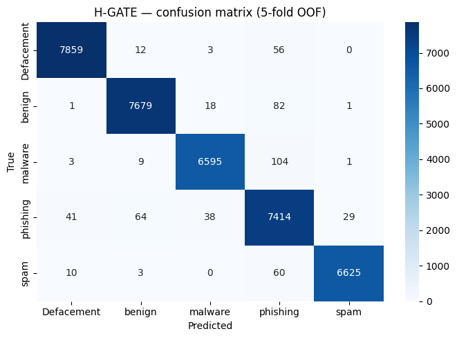
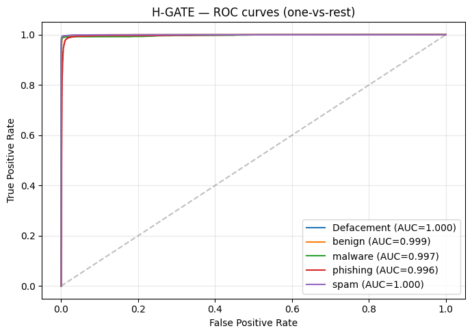
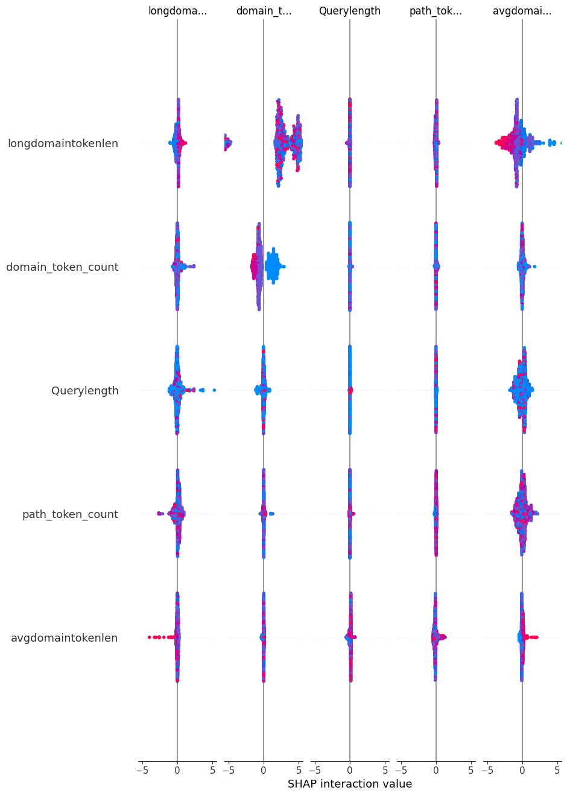

# H-GATE: malicious URL detection with a gradient-boosted attention-transformer ensemble

I built H-GATE for multi-class classification of malicious URLs on the ISCX-URL2016 dataset.
Four base learners (an FT-Transformer, a focal-loss LightGBM, XGBoost and CatBoost) are
stacked through out-of-fold predictions and a logistic meta-learner, then tuned with Harris
Hawks Optimization and explained with SHAP.

| Result | Value | Context |
| --- | --- | --- |
| Macro-F1 | 0.9856 | Stacking ensemble, five-fold out-of-fold |
| Macro-FPR | 0.37% | False positives averaged across classes |
| Macro-F1, vanilla XGBoost | 0.9839 | Same folds, single model |
| Macro-AUC | 0.9984 | Ensemble; vanilla XGBoost scored 0.9993 |



## Why the task is awkward

ISCX-URL2016 contains 36,707 URLs across five classes (defacement, benign, malware,
phishing, spam) with a severe class imbalance. Two things dominated my design:

1. **Missing features.** The raw URL and page metadata are sparse and inconsistent across
   captures, so imputation and feature engineering happen before any model sees a row.
2. **The wrong metric.** Accuracy is useless here. The class that matters is the rare one,
   and a model that trades false positives for recall is worse than useless in a security
   setting. I therefore tuned the ensemble against a recall floor of 0.90 with per-class
   thresholds, and I report macro-FPR alongside macro-F1.

## Method

- **Preprocessing.** Iterative imputation plus engineered lexical and host features.
- **Four base learners.** FT-Transformer (lightweight PyTorch implementation), LightGBM
  with a custom focal-loss gradient, XGBoost and CatBoost.
- **Stacking.** Five-fold out-of-fold probabilities feed a logistic meta-learner. I apply
  SMOTE-NC inside each training fold, never before the split.
- **Thresholds.** Per-class thresholds are searched against a 0.90 recall floor. This is
  where most of the false-positive reduction comes from.
- **Harris Hawks Optimization.** A 14-dimensional joint hyperparameter vector (ensemble
  weights, tree depth and leaves, learning rate, regularisation) is searched with a
  self-contained HHO implementation, scored by cross-validated macro-F1 on a stratified
  subsample.
- **Interpretability.** SHAP on the LightGBM branch.

## Results

| Model | Macro-F1 | Macro-AUC |
| --- | --- | --- |
| XGBoost baseline | 0.9839 | 0.9993 |
| H-GATE (stacked, tuned) | 0.9856 | 0.9984 |





My honest reading: the ensemble buys about 0.0017 macro-F1 over a single tuned XGBoost and
is marginally *worse* on macro-AUC. The gain is real but small, and the macro-AUC caveat is
the reason this project reports both numbers instead of only the flattering one.

**Evaluation caveat.** All numbers are five-fold out-of-fold predictions on the full
dataset, not an independent held-out test set. That inflates every number slightly and it is
why the comparison against vanilla XGBoost matters more than the absolute value.

## Repository layout

```text
notebooks/hgate-url-detection.ipynb   full pipeline, from data loading to SHAP
assets/                               the three figures used below
data/README.md                        dataset source and licence
```

Commit dates reflect when the work was done. I reconstructed the history from the Colab
exports, the figures and the report, because the project was written in a notebook and never
tracked in git.

## Running it

I developed the notebook on Colab and Kaggle. It expects the ISCX-URL2016 CSV files next to
it (see `data/README.md`), a GPU for the FT-Transformer branch and roughly 8 GB of RAM for
the stacking step.

```bash
pip install -r requirements.txt
jupyter notebook notebooks/hgate-url-detection.ipynb
```

Sections 0 to 13 run in order. Sections 9 and 10 (HHO search, final refit) are the slow
part; the notebook caches intermediate arrays so a re-run does not start from zero.

## Team and context

This was a course project for the Data Security module (2SC IASD, ESI-SBA, 2025/2026, taught
by M. Khaldi). The report lists four students: Aini Ines, Ben Terki Abdel-Ouakil, Benayed
Mohammed Amjed and Medjahri Mohammed Safouane.

I wrote the implementation in this repository: the four base learners, the stacking
pipeline, the threshold search, the HHO run and the SHAP analysis.

## References

- X. Huang et al. (2020), "TabTransformer: Tabular Data Modeling Using Contextual
  Embeddings".
- G. Ke et al. (2017), "LightGBM: A Highly Efficient Gradient Boosting Decision Tree",
  NeurIPS.
- T.-Y. Lin et al. (2017), "Focal Loss for Dense Object Detection", ICCV.
- A. A. Heidari et al. (2019), "Harris Hawks Optimization: Algorithm and Applications",
  Future Generation Computer Systems.
- ISCX-URL2016, Canadian Institute for Cybersecurity, University of New Brunswick.

More about this project on my portfolio:
https://safouane-medjahri.vercel.app/projects/h-gate
